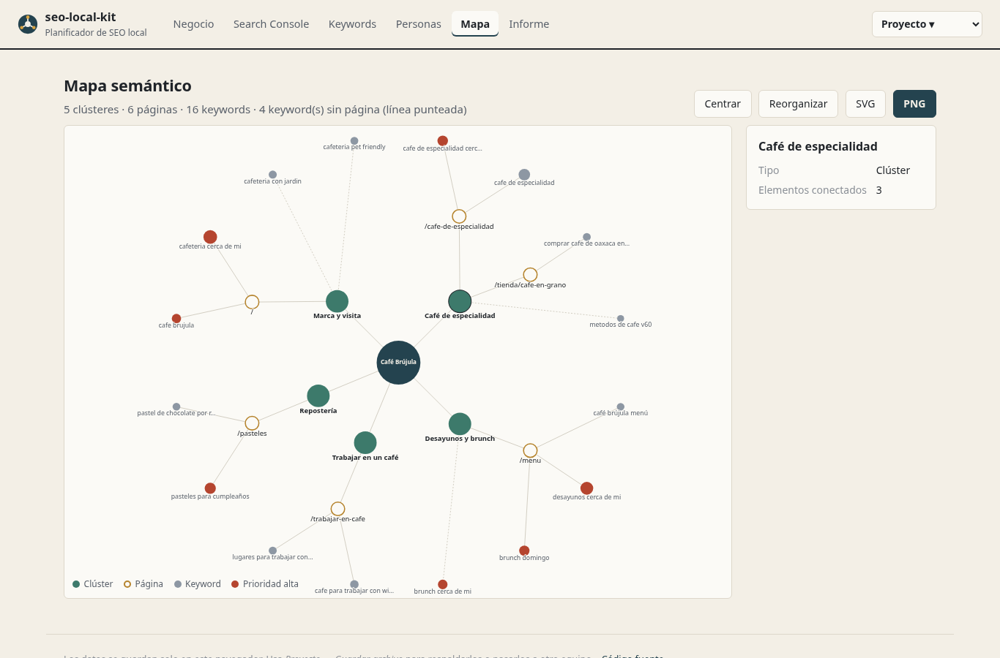
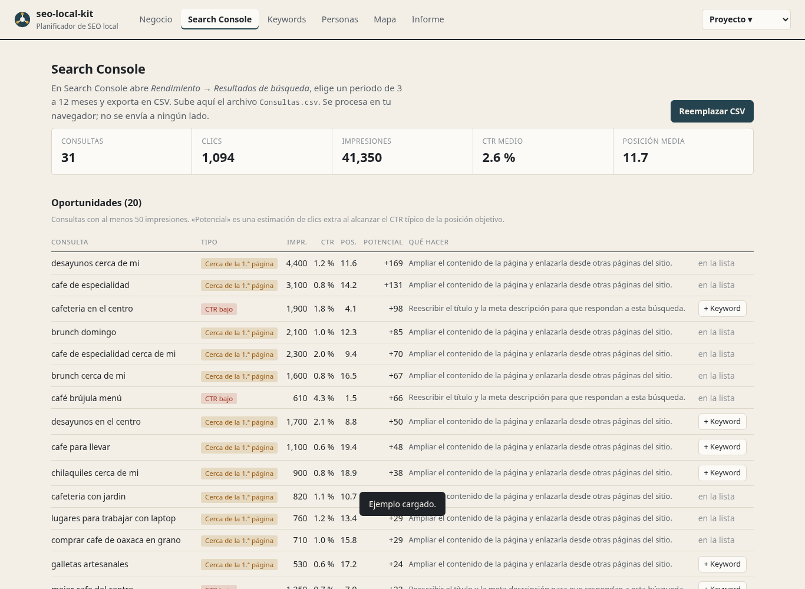

# seo-local-kit

**Español** · [English](#english)

Herramienta web para planificar el SEO de un negocio local: restaurante, cafetería, consultorio, taller, tienda. Reúne en un solo lugar lo que normalmente queda repartido entre hojas de cálculo, documentos y diagramas, y genera un informe para entregar al cliente.

**[Probar la demo →](https://martinezmarianotea-code.github.io/seo-local-kit/)** (en *Proyecto → Cargar ejemplo* hay una cafetería ficticia con datos simulados)



## Qué hace

| Sección | Para qué sirve |
|---|---|
| **Negocio** | Ficha con nombre, dirección, horario, coordenadas y redes. Genera el marcado **schema.org JSON-LD** (`LocalBusiness`, `Restaurant`, `Dentist`…) listo para pegar en el sitio y avisa qué datos recomendados por Google faltan. |
| **Search Console** | Importa el CSV de consultas de Google Search Console (en español o inglés) y detecta **oportunidades**: búsquedas en posiciones 8–20 que están cerca de la primera página, y búsquedas en el top 10 con un CTR muy por debajo de lo esperado. Estima cuántos clics extra se podrían ganar. |
| **Keywords** | Clústeres temáticos, páginas del sitio y keywords con intención, prioridad y página destino. Clasifica consultas por clúster, avisa de keywords importantes sin página y de títulos demasiado largos. Exporta a CSV. |
| **Personas** | Buyer personas con objetivos, frustraciones, cómo buscan en Google y qué objeciones debe responder el sitio. |
| **Mapa** | Mapa semántico que se **arma solo** con los datos: negocio → clústeres → páginas → keywords. Las keywords sin página se muestran con línea punteada. Se puede mover, acercar y exportar a PNG o SVG. |
| **Informe** | Documento con la ficha, el schema, la situación en Google, la arquitectura con el mapa y las personas. Se imprime como PDF o se descarga en HTML o Markdown. |



## Privacidad

Todo corre en el navegador. Los proyectos se guardan en el `localStorage` de cada usuario y el CSV de Search Console nunca sale del equipo. Para respaldar o compartir un proyecto se usa *Proyecto → Guardar archivo* (un `.seo.json`).

## Usarlo en tu equipo

No necesita instalar dependencias, solo servir los archivos (los módulos de JavaScript no cargan desde `file://`):

```bash
git clone https://github.com/martinezmarianotea-code/seo-local-kit.git
cd seo-local-kit
python3 -m http.server 8080      # o: npx serve
```

Abre <http://localhost:8080>.

## Cómo exportar el CSV de Search Console

1. En [Search Console](https://search.google.com/search-console) abre **Rendimiento → Resultados de búsqueda**.
2. Elige un periodo de 3 a 12 meses.
3. Pulsa **Exportar → Descargar CSV** y descomprime el ZIP.
4. En la pestaña *Search Console* importa `Consultas.csv`.

## Cómo se calculan las oportunidades

- **Cerca de la 1.ª página:** posición media entre 8 y 20 y al menos 50 impresiones. El potencial supone llegar a la posición 5.
- **CTR bajo:** posición media menor a 8 y un CTR menor a la mitad del esperado para esa posición, según una curva de CTR orgánico de referencia (`EXPECTED_CTR` en `js/gsc.js`).

Son reglas simples y transparentes para priorizar, no una predicción exacta.

## Estructura

```text
index.html, css/app.css
js/
  main.js          pestañas y menú de proyecto
  store.js         estado, guardado local, importar/exportar
  gsc.js           lectura del CSV de Search Console y oportunidades
  schema.js        generador de JSON-LD
  mapmodel.js      grafo, acomodo radial y SVG del mapa
  report.js        informe en HTML y Markdown
  csv.js, ui.js
  views/           una vista por pestaña
examples/          proyecto y CSV de ejemplo (negocio ficticio)
scripts/make_example.py
tests/             pruebas con node --test
```

## Pruebas

```bash
node --test
```

## Licencia

[MIT](LICENSE)

---

## English

seo-local-kit is a browser-based planner for local SEO (restaurants, cafés, clinics, shops). It brings together what usually lives in scattered spreadsheets and diagrams, and produces a report you can hand to a client.

**[Try the demo →](https://martinezmarianotea-code.github.io/seo-local-kit/)** (use *Proyecto → Cargar ejemplo* to load a fictional café with simulated data). The interface is in Spanish.

- **Business profile → schema.org JSON-LD** for `LocalBusiness` and its subtypes, with a check of the fields Google recommends.
- **Search Console import** (Spanish or English CSV headers) that flags queries close to page one (positions 8–20) and top-10 queries with an unusually low CTR, with an estimate of the extra clicks.
- **Keywords, clusters and pages**: intent, priority and target page per keyword, auto-clustering by terms, CSV export.
- **Buyer personas** with goals, frustrations, searches and objections.
- **Semantic map** generated from the data (business → clusters → pages → keywords), draggable and exportable to PNG/SVG.
- **Report** as printable HTML/PDF or Markdown.

Everything runs locally in the browser; no data is sent anywhere. No build step or dependencies: serve the folder with any static server (`python3 -m http.server`). Tests: `node --test`.

Licensed under the [MIT License](LICENSE).
